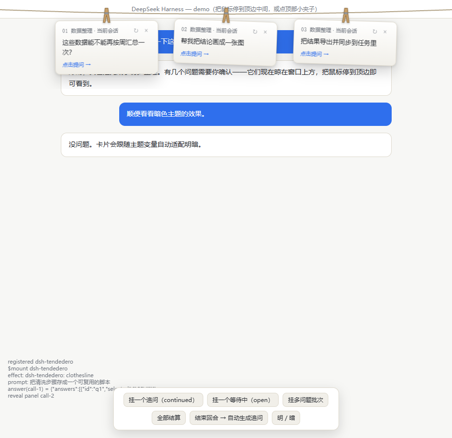

# dsh-tendedero

Hang DSH follow-up questions on a clothesline above the window — inspired by [alejandrobujan/tendedero](https://github.com/alejandrobujan/tendedero).



**Live demo:** open [`index.html`](index.html) (or the GitHub Pages site once enabled). It runs the real client bundle against a mock host, so you can try the whole interaction without DSH.

## What it does

- After each completed turn, the plugin asks the session's current model for three short follow-up questions and hangs **one card per question**, each on its own clothespin.
- **Click a card** to send that question as your next message; the whole batch is then pulled off the line to the right, picked card first.
- **Hover or rest the pointer anywhere on the top strip** (full width, ~48px deep, including the title bar and both corners) to glide the line back down; move away and it tucks up.
- Agent `ask_user_question` cards hang on the same line; left-over questions can be answered on the card, live ones hand back to the composer.
- Batches survive a page reload / session re-entry for ~6 minutes; they are cleared when the session starts working again, when a real question appears, on `×`, or on expiry.
- Light/dark theme aware; respects `prefers-reduced-motion`.

## Install (DSH)

Add the package to a profile and enable the bundle, then `pnpm install` in the profile dir:

```jsonc
// ~/.dsh/profiles/<profile>/package.json
{
  "dependencies": { "dsh-tendedero": "^0.4.2" },
  "dsh": { "profile": { "bundles": ["…", "dsh-tendedero"] } }
}
```

Or from the DSH Plugins page once published to npm. Restart DSH after first install (the host Remote row is added by the bundle patch).

## Configuration

Optional override in the profile's `cordis.patch.yml`:

```yaml
- id: dsh-tendedero
  name: dsh-tendedero
  config:
    enabled: true        # master switch
    maxQuestions: 3      # cards per batch (1-5)
    provider: null       # pin the generation model; defaults to the session's model
    model: null
    timeoutMs: 45000
```

The hover trigger depth is `TRIGGER_DEPTH` at the top of `lib/client.js`.

## How it works

- Host half (`lib/index.js`, `lib/remote.js`): a `tendedero/suggest` Remote method reads the latest user/assistant messages and generates questions through the shared `ctx.llm` service.
- Client half (`lib/client.js`): a lazy-CJS module-loader bundle, no build step and no runtime dependencies. It watches `userQuestions`/`inbox` projections and `sessionStatus`, renders the clothesline in plain DOM/CSS, and sends picks via `session/prompt`.
- Dynamically mounted Remote namespaces are read with `ctx.get()` (Cordis only allows property reads for keys declared in `inject`).

## Development / tests

`index.html` is a standalone harness that mirrors the host's Cordis `inject` rule and the `{ok,value}` Remote envelope. 31 state assertions (hover recall, dismissal, reload/re-entry restore, running-session sweep, reconnect) were run against it with ego-browser during development.

## License

MIT. Not affiliated with the original tendedero app; this re-implements its top-line interaction for DSH.
