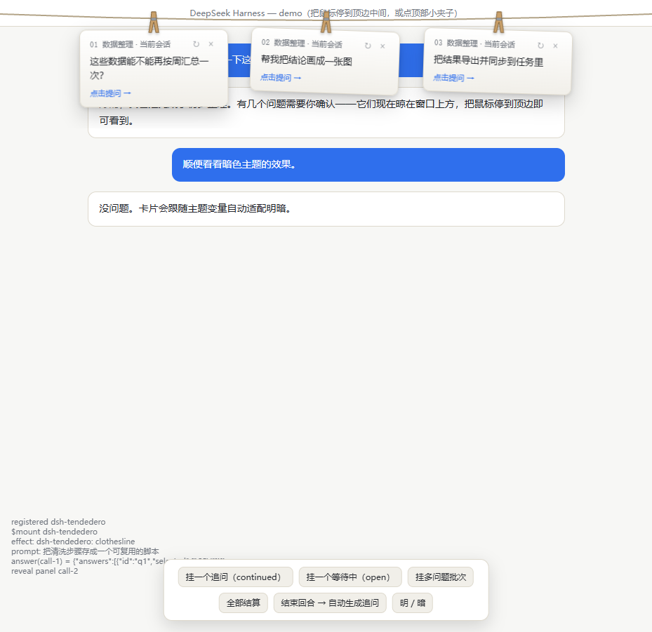

# dsh-tendedero（晾问绳）v0.4.2

灵感来自 [alejandrobujan/tendedero](https://github.com/alejandrobujan/tendedero)。把 DSH 的追问变成晾在窗口上方晾衣绳上的纸卡片。



在线演示：打开仓库里的 `index.html`（或启用后的 GitHub Pages 站点），无需 DSH 即可体验全部交互。

## 两种追问，都晾在绳子上

**1. 自动推荐追问：三条卡片**
每当一个回合正常结束（Agent 回答完、且没有正在等待的提问），插件用当前会话的同一个模型生成三条你接下来大概率想问的短句，**一条一个追问，各挂各的夹子**：

- **点某一条卡片 = 选了它**：这条追问立刻作为新消息发出，回答随即开始；
- 选完后**整批三条一起从夹子上往右边抽走**（选中的那条先走，其余紧随其后），绳子随后收回；
- 卡片右上角 `↻` 换一批，`×` 先收起来；下次回答结束后会再挂新的一条；
- 若你不点卡片、自己敲了下一句（回合重新开始），旧的一批自动摘掉，不会留着过期建议；
- 缩回之后：**鼠标划过或停在窗口顶边、或停在顶部那个小夹子上，绳子会重新垂下来**，卡片还在原处；移开又收回，反复都可以。离开窗口（切到别的应用）会自动收回。
- 一批追问在 **6 分钟内可跨刷新、跨重进会话恢复**：恢复时不会自己垂下来，划过去才展开；剩余挂起时间按原始时间计算。
- 卡片真正消失只有这几种情况：你点了其中一张、这个会话重新开始工作、Agent 的正式提问出现（推荐卡让位）、你按了 `×`、或超过约 2.5 分钟没理它。
- Agent 主动提问的卡片优先级更高，它出现时同一会话的推荐批次会让位并被清掉。

**2. Agent 主动提问（ask_user_question）**
Agent 向你提问时同样挂卡。回合结束后留下的问题（continued）点开卡片可直接选择选项、填“其他回答”并提交或跳过；正在等待的问题（open）点“在输入框中回答”跳回官方卡片。

## 晾衣绳手势（tendedero 原版交互）

- 绳子平时收在窗口上方；**鼠标划过或停在顶部整条区域（全宽、约 48px 深，含标题栏与左右两角）**，整条绳子滑下来；移开自动收回。触发深度由 `lib/client.js` 顶部的 `TRIGGER_DEPTH` 控制，想更灵敏就调大。
- 收起时顶边垂着带数字的小夹子 = 有几个追问挂着，点击展开；Esc 随时收回。
- 新卡片到达时自动垂下约 3 秒提示。卡片挂在绳上轻摆；遵循系统“减少动态效果”；自动适配明暗主题。

## 配置（可选）

在 profile 的 cordis.patch.yml 里加覆盖项即可（不加就用默认值）：

```yaml
- id: dsh-tendedero
  name: dsh-tendedero
  config:
    enabled: true          # 总开关（关掉后两种追问都不再挂；默认 true）
    maxQuestions: 3        # 每条绳子挂几张追问卡，1–5（默认 3）
    provider: null         # 指定生成用模型 provider；默认跟随会话当前模型
    model: null            # 指定生成用模型；与 provider 成对填写
    timeoutMs: 45000       # 生成超时
```

## 安装

插件页安装，或手动把本包加入 profile（package.json 的 dependencies 加 link、dsh.profile.bundles 加名字），然后在 profile 目录运行 pnpm install。

改了宿主侧文件（lib/index.js、lib/remote.js 或 bundle 的 cordis.patch.yml）需要**重启 DSH**；只改客户端 lib/client.js 时刷新页面即可。

## 状态覆盖测试

31 条状态断言全部通过（用 ego-browser 对独立演示 `index.html` 运行，覆盖以下场景）：

- **召回**：自动收回后悬停顶边、悬停顶部小夹子、反复移开再划回、只有提问卡时、两类卡同时挂着、失败卡在场。
- **消失**：点选抽走、回合重开、静默运行中（状态边沿丢失时靠投影刷新扫掉）、正式提问让位、`×` 收起、超时过期、无卡时悬停不展开。
- **重进会话 / 刷新**：恢复并可点选发送、恢复时不自动垂下、过期记录不恢复且从存储清掉、未知会话记录丢弃、会话正在运行不恢复、多会话批次同时恢复、按剩余时间到期、加载时就有提问卡则不恢复。
- **其它**：切走窗口自动收回、断线重连后批次保留。

## 排查：绳子上一张卡都没有

v0.3.1 起，生成失败**不再静默**：绳子会挂出一张红色的「追问生成失败」卡，写明原因，点它可以重试。常见三种：

| 卡片写的 | 含义 | 处理 |
|:--|:--|:--|
| 「宿主侧 dsh-tendedero/remote 未加载（重启 DSH 后生效）」 | 浏览器里有晾衣绳，但宿主侧的生成入口没挂载 | 重启一次 DSH |
| 「cannot get property … without inject」 | v0.4.0 自身的 bug：动态挂载的 remote 命名空间不能用属性读 | 已在 v0.4.1 修掉，刷新页面即可 |
| 「模型 X/Y 不可用：…」 | 会话当前用的那个模型不能用来做这次短生成（缺 key、额度、网关不通等） | 换个模型，或在配置里显式指定 provider/model |
| 「模型没有返回可用的追问」 | 模型答非所问、没吐出 JSON 数组 | 点重试；仍不行就换模型 |

另外这些情况下本来就不该挂：回合结束时 Agent 正等你的提问（那张卡优先）、会话正在运行、或你刚自己发了新消息（旧那批会自动摘掉）。

**版本历史**：
- v0.4.2：触发区从「中间 70% 宽 × 26px」扩大为「全宽 × 48px」，标题栏和左右两角现在都能召回；深度可用 `TRIGGER_DEPTH` 调整。

- v0.4.1：`remote.tendedero` / `remote.session` 改走 `ctx.get()` —— Cordis 只允许属性读取 `inject` 中声明过的键，动态挂载的命名空间不在其中。同时把离线演示的 mock 改成强制执行这条规则，同类问题以后会在测试里直接炸出来，不会再出现「演示全绿、真机失败」。
- v0.4.0：顶边与小夹子悬停召回（此前只统计提问卡，导致推荐卡召回失效）、批次 6 分钟内跨刷新与重进会话恢复、运行中会话的双保险清扫、窗口失焦自动收回。
- v0.3.1 修了两个真因 —— 客户端把 Remote 返回的 `{ok,value}` 信封当成业务值（导致永远解析不到问题、且不报错）；宿主取模型路由时读了不存在的 `message.request`，实际路由记在助手消息的 `message.source` 上，于是走了兜底 provider。v0.3.0 把「一张卡装三条」改成「三条追问三张卡，点一张即选中，整批向右抽走」。

## 实现

- 宿主半侧 lib/index.js 提供配置；lib/remote.js（dsh-tendedero/remote）实现 tendedero/suggest：取会话最近的用户请求与助手回答，经共享 ctx.llm 服务生成问题 JSON 并严格解析，默认跟随会话当前模型。
- 客户端半侧：订阅各会话 userQuestions/inbox 投影挂提问卡；通过 uiSession.sessionStatus 观察 running 由真转假且无 pending 交互时触发 suggest，一批三张卡；点卡片走官方 session/prompt（mode: queue）；发送成功或回合重启时把整批摘掉。
- 纯 DOM + CSS，无第三方依赖，无构建步骤；描述符手写注册，无需 typert 代码生成。
